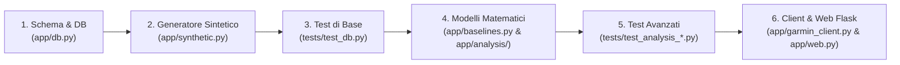
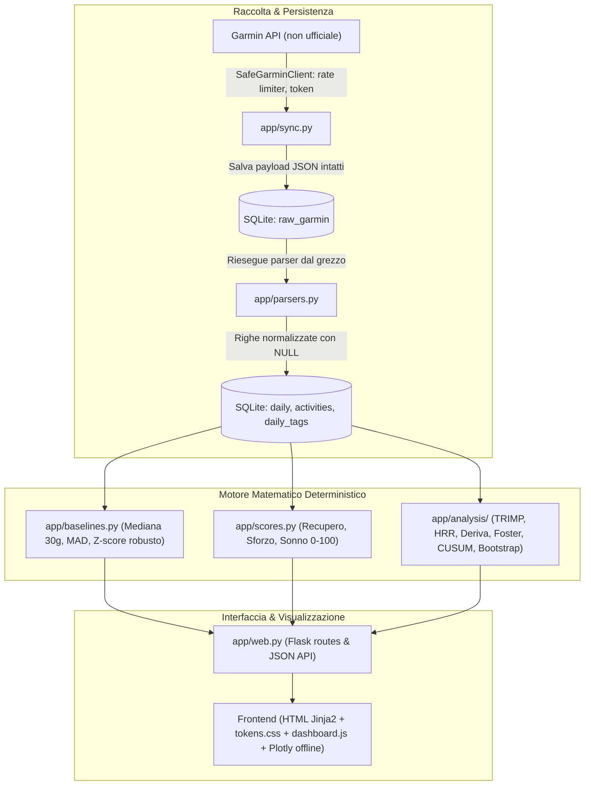

# Guida Completa all'Architettura, ai Modelli Matematici e ai Test Automatici
### Roadmap di Apprendimento e Studio del Codice — Garmin Personal Dashboard

Questa guida raccoglie in un unico documento organico tutto ciò che serve per comprendere a fondo il progetto: **come orientarsi tra i file**, **la logica delle scelte ingegneristiche**, **i modelli matematici/fisiologici deterministici** e **come funzionano i test automatici in Python**.

---

## 🗺️ Roadmap per Leggere e Studiare il Codice

Se vuoi esplorare e comprendere l'intero progetto da studente di fisica/ingegneria, segui questo percorso ordinato in 6 tappe:



### Tappa 1: Le fondamenta dei dati — [`app/db.py`](app/db.py)
- **Cosa fa**: definisce le tabelle SQLite (`SCHEMA_SQL`) e le funzioni pure di lettura/scrittura (`upsert_raw`, `replace_daily`, `upsert_activity`, `toggle_day_tag`).
- **Cosa osservare**: nota come usiamo `COALESCE` e `ON CONFLICT` per ottenere l'idempotenza e come i dati mancanti restano rigorosamente `NULL` e mai `0`.

### Tappa 2: L'esperimento Monte Carlo controllato — [`app/synthetic.py`](app/synthetic.py)
- **Cosa fa**: genera 90 giorni di dati realistici con correlazioni matematiche note inserite apposta (es. una notte breve causa un calo di HRV il giorno dopo, un allenamento duro alza la frequenza cardiaca a riposo).
- **Cosa osservare**: l'uso di `np.random.default_rng(seed=42)` per generare rumore riproducibile e la sintesi di ipnogrammi e serie al secondo.

### Tappa 3: Il primo approccio ai test — [`tests/test_db.py`](tests/test_db.py) e [`tests/test_synthetic.py`](tests/test_synthetic.py)
- **Cosa fa**: verifica l'idempotenza degli inserimenti e controlla che il motore statistico ritrovi le correlazioni note generate nella Tappa 2.
- **Cosa osservare**: il funzionamento della fixture `tmp_path` e l'uso dell'istruzione `assert`.

### Tappa 4: Il motore algoritmico deterministico — [`app/baselines.py`](app/baselines.py) e [`app/analysis/`](app/analysis/)
- **Cosa fa**: tutti i calcoli scientifici senza machine learning:
  - [`app/baselines.py`](app/baselines.py): Mediana a 30 giorni e dispersione robusta MAD.
  - [`app/analysis/activity.py`](app/analysis/activity.py): TRIMP esponenziale, modello Banister ATL/CTL/TSB, Foster Monotony/Strain, HRR60/120, Deriva FC.
  - [`app/analysis/sleep.py`](app/analysis/sleep.py): cicli del sonno, latenze N3/REM, statistica circolare per il ritmo circadiano (SRI, Social Jetlag).
  - [`app/analysis/recovery_trends.py`](app/analysis/recovery_trends.py): Banda HRV $k\cdot\text{SD}$, Bootstrap IC 95%, Theil-Sen, Mann-Kendall, CUSUM.
- **Cosa osservare**: ogni funzione è pura (non tocca database o rete), ha una docstring dettagliata e restituisce `make_result` o `make_not_calculable`.

### Tappa 5: La verifica scientifica — [`tests/test_analysis_activity.py`](tests/test_analysis_activity.py) e [`tests/test_analysis_recovery_trends.py`](tests/test_analysis_recovery_trends.py)
- **Cosa fa**: collauda ogni formula entro tolleranze numeriche dichiarate e verifica la gestione di casi limite (dati mancanti, stop anticipato dell'orologio, finestre insufficienti).

### Tappa 6: L'integrazione Garmin, il Web e la UI — [`app/sync.py`](app/sync.py), [`app/web.py`](app/web.py), [`static/js/dashboard.js`](static/js/dashboard.js)
- **Cosa fa**:
  - [`app/sync.py`](app/sync.py): sincronizzazione incrementale con token locali e salvataggio grezzo.
  - [`app/web.py`](app/web.py): rotte Flask, calcolo su richiesta, API JSON e background thread per il sync.
  - [`static/js/dashboard.js`](static/js/dashboard.js): grafici Plotly offline, mini-calendario dei giorni disponibili, parser LaTeX artigianale.

---

## 🏛️ 1. Architettura dei Livelli (Separazione delle Responsabilità)

In ingegneria del software, la **Separation of Concerns** evita che un cambio di formato esterno distrugga i calcoli interni:



### Perché la tabella `raw_garmin` è fondamentale?
Se scaricassi i dati e li inserissi direttamente nella tabella finale `daily`:
1. Perdere tutti i dati non ancora gestiti dai parser.
2. Se volessi aggiungere una metrica (es. la SpO2 minuto per minuto) dovresti riscaricare mesi di dati dai server Garmin, rischiando blocchi di rate limiting o login.
Con `raw_garmin(day, endpoint, payload_json)`:
- Il payload JSON originale viene salvato intatto.
- Puoi riscrivere da zero i parser in [`app/parsers.py`](app/parsers.py) ed eseguire `reparse_all_from_raw()` in 0.5 secondi offline.
- La chiave primaria composta `(day, endpoint)` garantisce l'**idempotenza**: rilanciare il sync aggiorna la riga senza creare duplicati.

---

## 📐 2. I Modelli Matematici e Fisiologici

### A. Statistica Robusta (Mediana e MAD vs Media e Deviazione Standard)
Nella fisiologia umana, i dati presentano spesso outlier estremi (es. una notte con 2 ore di sonno per un viaggio, o un picco di battiti anomalo per un movimento del braccio).
- La **media aritmetica** $\mu$ e la **deviazione standard** $\sigma$ hanno un *breakdown point* dello $0\%$: basta un singolo valore assurdo per distorcere l'intera baseline.
- Usiamo quindi la **Mediana** $m = \text{mediana}(X)$ e il **MAD** (*Median Absolute Deviation*):
  $$\text{MAD} = \text{mediana}\left(|x_i - m|\right)$$
- Per confrontarlo con una deviazione standard gaussiana, si moltiplica per il fattore di consistenza:
  $$\hat{\sigma}_{\text{rob}} = 1.4826 \cdot \text{MAD}, \quad \text{dove } 1.4826 = \frac{1}{\Phi^{-1}(0.75)}$$
- Lo **Z-score robusto** diventa:
  $$z_{\text{rob}} = \frac{x - m}{\hat{\sigma}_{\text{rob}}}$$
  Se $|z_{\text{rob}}| \le 0.75$, il valore è *in linea con la norma personale*; sopra o sotto indica deviazioni fisiologiche reali.

### B. Carico Acuto/Cronico (Modello Impulso-Risposta di Banister)
Il modello fitness-fatica tratta il corpo umano come un **sistema dinamico lineare tempo-invariante** sollecitato da impulsi di carico giornaliero $L_t$ (TRIMP):
- **Fatica (Carico Acuto ATL, $\tau = 7$ giorni)**: decade rapidamente.
- **Fitness (Carico Cronico CTL, $\tau = 28$ giorni)**: decade lentamente.
- Equazioni ricorsive (filtro esponenziale IIR del primo ordine):
  $$\text{ATL}_t = \alpha_7 L_t + (1 - \alpha_7)\text{ATL}_{t-1}, \quad \alpha_7 = \frac{2}{7 + 1} = 0.25$$
  $$\text{CTL}_t = \alpha_{28} L_t + (1 - \alpha_{28})\text{CTL}_{t-1}, \quad \alpha_{28} = \frac{2}{28 + 1} \approx 0.069$$
- **Bilancio Forma/Freschezza (TSB)**:
  $$\text{TSB}_t = \text{CTL}_t - \text{ATL}_t$$
- **Rapporto ACWR**: $\text{ACWR}_t = \frac{\text{ATL}_t}{\text{CTL}_t}$ (zona ottimale $0.80 \le \text{ACWR} \le 1.30$).

### C. Monotonia e Strain Settimanale di Foster (1998)
Un carico elevato ma ben alternato (giorni duri seguiti da giorni leggeri) stimola l'adattamento; un carico anche moderato ma identico ogni giorno impedisce la rigenerazione:
$$\text{Load}_{7g} = \sum_{i=1}^{7} L_i, \quad \text{Monotonia} = \frac{\overline{L}_{7g}}{s_{L,7g}}, \quad \text{FosterStrain} = \text{Load}_{7g} \times \text{Monotonia}$$
Se $s_L$ è vicina a zero (carico piatto), la monotonia sale verso il tetto di $4.0$, facendo schizzare lo Strain.

### D. Statistica Circolare per il Ritmo Circadiano
Gli orari di addormentamento oscillano attorno alla mezzanotte (es. 23:45 e 00:15). Se facessi la media aritmetica standard tra $23.75$ e $0.25$, otterresti $12.00$ (mezzogiorno!), un errore madornale.
In [`app/analysis/sleep.py`](app/analysis/sleep.py):
- Mappiamo gli orari sulla circonferenza goniometrica con angolo $\theta_i = 2\pi \frac{t_i}{24 \cdot 60}$.
- Calcoliamo le coordinate cartesiane medie $(\bar{C}, \bar{S}) = \left(\frac{1}{N}\sum \cos\theta_i, \, \frac{1}{N}\sum \sin\theta_i\right)$.
- L'orario medio è $\bar{\theta} = \text{atan2}(\bar{S}, \bar{C})$, e la dispersione angolare dà la deviazione standard circolare corretta.

### E. Bootstrap Non Parametrico (Effetto Allenamento → Recupero)
In [`app/analysis/recovery_trends.py`](app/analysis/recovery_trends.py), per calcolare se una seduta dura riduce davvero l'HRV della notte successiva senza assumere che i dati seguano una curva a campana perfetta:
1. Calcoliamo la differenza osservata $\Delta = \overline{\text{HRV}}_{\text{dura}} - \overline{\text{HRV}}_{\text{facile}}$.
2. Eseguiamo $2000$ iterazioni di **ricampionamento con reinserimento** (*Monte Carlo bootstrap*).
3. Calcoliamo i percentili $2.5\%$ e $97.5\%$ per ottenere l'intervallo di confidenza al $95\%$. Se l'intervallo non attraversa lo zero (es. $[-6.2, -1.8]$ ms), l'effetto è statisticamente significativo.

### F. Pendenza di Theil-Sen, Test di Mann-Kendall e CUSUM
- **Theil-Sen**: pendenza mediana di tutte le coppie di punti $\frac{y_j - y_i}{t_j - t_i}$, insensibile a outlier fino al $29\%$.
- **Mann-Kendall**: test di ipotesi non parametrico sulla monotonicità della serie temporale (restituisce statistica $Z$ e $p$-value).
- **CUSUM**: somma cumulativa delle deviazioni dalla media per intercettare istantaneamente il giorno in cui la serie ha cambiato regime fisiologico.

---

## 🧪 3. Come Funzionano i Test Automatici (`pytest`)

Quando scrivi codice scientifico spesso fai una verifica "a occhio": lanci uno script, stampi con `print()` e controlli se sembra sensato. Il problema è che quando il progetto cresce dovresti ricontrollare tutto a mano a ogni modifica.

`pytest` automatizza questo processo:
1. **Scopre i test da solo**: cerca tutti i file che iniziano con `test_` ed esegue tutte le funzioni `def test_...()`.
2. **Verifica le condizioni con `assert`**: `assert condizione` non fa nulla se la condizione è vera (`True`), ma solleva un errore (`AssertionError`) se è falsa (`False`), mostrandoti il confronto tra valore atteso e calcolato.
3. **Isola ogni test**: se hai 31 test, ognuno parte da uno stato pulito e non sporca i dati degli altri.

### Cosa fa `pytest.ini`?
```ini
[pytest]
pythonpath = .
testpaths = tests
```
- `pythonpath = .`: aggiunge la cartella principale del progetto ai percorsi in cui cercare i moduli. Senza questa riga, scrivendo `from app import db` dentro `tests/test_db.py`, Python cercherebbe `app` solo dentro `tests/` e darebbe `ModuleNotFoundError`.
- `testpaths = tests`: dice a `pytest` dove cercare i test quando lanci `./env/bin/pytest`.

### Il "trucco" di `tmp_path`: le *fixture* di `pytest`
In `tests/test_db.py`:
```python
def test_init_and_raw_upsert_idempotent(tmp_path: Path) -> None:
    conn = db.connect(tmp_path / "test.db")
    db.init_db(conn)
```
`tmp_path` è una fixture integrata di `pytest`: prima di eseguire la funzione, crea una cartella temporanea nuova nel sistema operativo (`/tmp/...`) e ne passa il percorso (`Path`) alla funzione. A fine test la cartella viene cancellata. In questo modo il tuo database vero in `data/` non viene **mai** toccato dai test.

### Il *Monkeypatching*: testare senza rete
In [`tests/test_sync_and_parsers.py`](tests/test_sync_and_parsers.py), non possiamo fare chiamate vere a Garmin nei test.
Usiamo `monkeypatch`, che consente di sostituire a runtime un metodo vero con uno finto (*mock*):
```python
def fake_fetch_day_bundle(self, day_str, include_extended=True):
    return {"summary": {"totalKilocalories": 2100}}

monkeypatch.setattr(SafeGarminClient, "fetch_day_bundle", fake_fetch_day_bundle)
res = sync.sync_garmin_data(conn, client, days=1)
assert res["status"] == "ok"
```

### Il Metodo Monte Carlo: Perché Dati Sintetici se Abbiamo Quelli Reali?
Una domanda tipica di fisica/ingegneria è: *se abbiamo già le risposte reali della Garmin sul dispositivo, che senso ha costruire un generatore sintetico Monte Carlo?*

Ci sono **4 motivi scientifici e ingegneristici fondamentali**:
1. **Verifica della "Verità a Priori" (*Ground Truth Validation*)**:
   - Nei dati biologici reali, la vera legge fisiologica sottostante è incognita e confusa da mille variabili non controllate (stress, alimentazione, temperatura, rumore del sensore). Se l'algoritmo calcola una correlazione tra carico e calo di HRV pari a $-0.45$, non puoi sapere a priori se il codice è corretto o se contiene un bug matematico.
   - Con la simulazione Monte Carlo ([`app/synthetic.py`](app/synthetic.py)), **imponiamo noi la legge fisica per costruzione**:
     $$\text{HRV}_t = 62 - 0.055 \cdot \text{Carico}_{t-1} + \eta_t, \quad \eta_t \sim \mathcal{N}(0, \sigma^2)$$
     Il test [`test_synthetic_known_correlations_recovered`](tests/test_synthetic.py) esegue l'algoritmo di analisi e verifica numericamente che esso recuperi esattamente il coefficiente inserito $\beta \in [0.045, 0.065]$. Se fallisce, sappiamo con certezza deterministica che c'è un errore nell'algoritmo.
2. **Stress Testing di Casi Limite e Singolarità (*Edge Cases*)**:
   - Per testare come reagisce la dashboard in caso di febbre acuta (caduta improvvisa di HRV e picco di RHR), settimana di infortunio (zero allenamenti per 14 giorni), notte completamente insonne o perdita di pacchetti del sensore (`NULL`), con i dati reali dovresti aspettare mesi o anni che questi eventi si verifichino. Con Monte Carlo li puoi generare istantaneamente e verificare che il sistema non collassi con divisioni per zero (`ZeroDivisionError`) o matrici singolari.
3. **Riproducibilità Deterministica nei Test (CI/CD)**:
   - I test automatizzati devono girare in meno di 2 secondi, offline e su qualsiasi computer, senza dipendere dal login Garmin. Fissando il seme del generatore pseudocasuale:
     ```python
     rng = np.random.default_rng(seed=42)
     ```
     la sequenza generata è identica bit per bit a ogni esecuzione, rendendo gli `assert` matematici solidi e riproducibili al 100%.
4. **Privacy e Modalità Demo (Zero Credenziali)**:
   - Permette a chiunque di testare l'intera interfaccia grafica, visualizzare grafici complessi e verificare il design system senza dover inserire credenziali Garmin reali e senza dover esporre i propri dati biometrici personali.

### Il Test Client di Flask (senza aprire porte di rete)
In [`tests/test_web.py`](tests/test_web.py):
```python
client = app.test_client()
response = client.get("/api/activity/100001/timeseries")
assert response.status_code == 200
assert response.get_json()["available"] is True
```
Il `test_client` simula richieste HTTP direttamente in memoria, testando routing, serializzazione JSON e rendering dei template Jinja2 in pochi millisecondi.

---

## 🎨 4. Frontend Offline e Tipografia Matematica

1. **Nessun CDN esterno**: Plotly è salvato in locale (`static/vendor/plotly.min.js`). La dashboard funziona anche offline e senza connessione internet.
2. **Motore LaTeX tipografico scritto da zero**: invece di caricare pesanti librerie esterne da 3-4 MB (come MathJax o KaTeX), [`static/js/dashboard.js`](static/js/dashboard.js#L18-L225) include un parser LaTeX ricorsivo di ~150 righe che converte frazioni (`\frac`), radici (`\sqrt`), sommatorie (`\sum`), cappelli (`\hat`), pedici/apici e simboli greci in elementi HTML semantici.
3. **Design Tokens CSS**: tutti i colori (Recupero `#2DD4BF`, Sforzo `#FB923C`, Sonno `#818CF8`), spaziatura a multipli di 4 px e font di sistema sono dichiarati in [`static/css/tokens.css`](static/css/tokens.css).

---

## 🛠️ 5. Esercizi Pratici per Approfondire

Per prendere confidenza con il codice, prova a fare questi piccoli esperimenti:

1. **Lanciare tutti i test**:
   ```bash
   ./env/bin/pytest -v
   ```
2. **Eseguire un solo test mirato**:
   ```bash
   ./env/bin/pytest tests/test_analysis_activity.py -k "test_cardiac_drift" -v
   ```
3. **Esperimento con Banister**:
   Apri Python interattivo nel terminale:
   ```python
   from app.analysis.activity import simulate_future_load
   res = simulate_future_load(atl_0=50.0, ctl_0=40.0, planned_loads=[100.0, 100.0, 0.0, 0.0, 120.0, 0.0, 0.0], start_day="2026-10-30")
   print("TSB finale:", res["value"]["end_tsb_form"])
   print("ACWR picco:", res["value"]["peak_acwr"])
   ```
4. **Ispezionare i tag giornalieri su SQLite**:
   ```bash
   sqlite3 data/garmin.db "SELECT * FROM daily_tags;"
   ```

